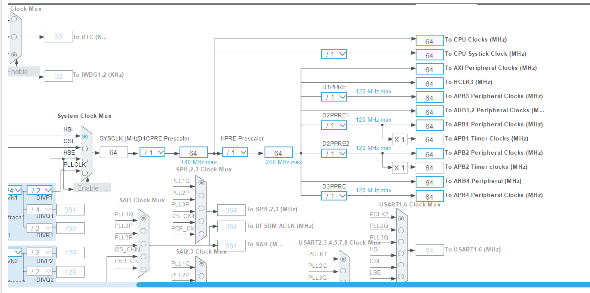

# Mini-ECU — Clock Configuration (STM32H753ZI)

## Objectif
Comprendre et vérifier la configuration des horloges du STM32H753ZI.

## Configuration CubeMX
- Source système : HSI
- Fréquence HSI nominale : 64 MHz
- PLL système : désactivée
- Prescaler CPU : /1
- Prescaler AHB : /1
- Prescalers APB1, APB2, APB3, APB4 : /1

### Clock Tree STM32H753ZI

## Fréquences attendues

| Horloge | Fréquence |
|---|---|
| SYSCLK | 64 MHz |
| CPU | 64 MHz |
| HCLK | 64 MHz |
| PCLK1 | 64 MHz |
| PCLK2 | 64 MHz |
| PCLK3 | 64 MHz |
| PCLK4 | 64 MHz |

## Module logiciel
- src/hal/clock.h
- src/hal/clock.c

Le module lit les fréquences configurées à l'aide des
fonctions HAL_RCC_Get*Freq().

## Validation
- STM32CubeIDE : compilation réussie, 0 erreur, 0 warning.
- Renode : lecture des champs de g_clock_info en RAM.
- SYSCLK : 0x03D09000 (64 MHz).
- HCLK   : 0x03D09000 (64 MHz).
- PCLK1  : 0x03D09000 (64 MHz).
- PCLK2  : 0x03D09000 (64 MHz).

## Limites
Les fréquences lues sont calculées par le firmware
à partir de sa configuration RCC.

Aucune mesure temporelle indépendante n'a été réalisée.
Renode utilise son propre modèle temporel : sa
fréquence simulée peut différer de celle supposée
par le firmware.

## Conclusion
La configuration RCC et la lecture des fréquences
par clock.c sont validées pour cette étape.
